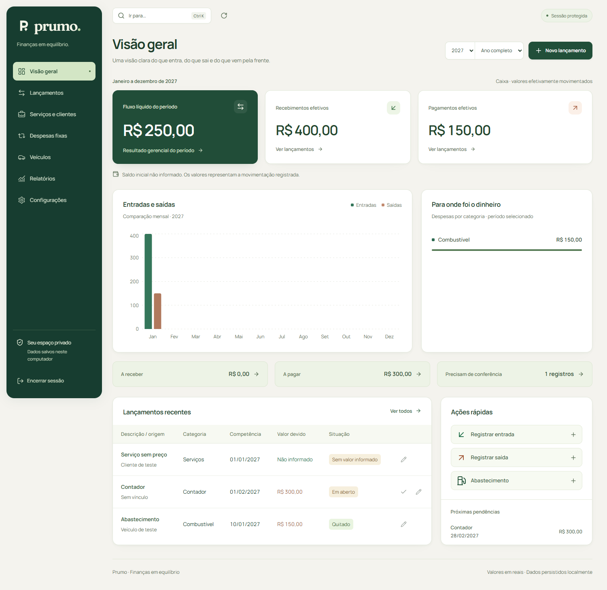

<div align="center">


# Prumo

**Finanças em equilíbrio.**

Seu financeiro em um só lugar: entradas, saídas, serviços, despesas fixas e veículos.
Com acesso individual, dados no seu computador e números que você consegue conferir.

**Local · Individual · Persistente**

[Começar](#começar) · [Conhecer as telas](#o-que-você-controla) · [Importar planilhas](#importar-planilhas) · [Fazer backup](#backup-e-restauração) · [Desenvolver](#desenvolvimento)

</div>

---

O Prumo organiza a rotina financeira sem exigir que você trabalhe dentro de uma planilha. Registre um compromisso, acompanhe suas baixas e entenda quanto entrou, quanto saiu e o que ainda precisa de atenção.

A aplicação funciona no navegador, com servidor e banco SQLite locais. As operações principais dispensam serviços externos e conexão com a internet depois da instalação. Não há cadastro público, mensalidade de uma API para operar ou dados de demonstração inseridos no banco de uso real.

## Por dentro do Prumo

O acesso usa grafite escuro, formulário central e animação discreta. Na área financeira, marfim e verde profundo organizam indicadores, gráficos e lançamentos. A interface está em português brasileiro, com reais e datas brasileiras.


<details>
<summary><strong>Ver a visão geral do financeiro</strong></summary>



Captura de um ambiente de testes, com registros e valores fictícios. Esses dados não são carregados na sua instalação.

</details>

## O que você controla

| Área                    | O que você faz                                                                                                       |
| ----------------------- | -------------------------------------------------------------------------------------------------------------------- |
| **Visão geral**         | Confere recebimentos, pagamentos, fluxo líquido, categorias, pendências e movimentações recentes.                    |
| **Lançamentos**         | Cadastra e edita compromissos, registra baixas parciais, consulta histórico, estorna pagamentos e cancela registros. |
| **Serviços e clientes** | Organiza clientes, serviços com vários itens, descontos explícitos e recebimentos vinculados à operação original.    |
| **Despesas fixas**      | Mantém recorrências mensais e gera contas previstas sem marcar pagamentos automaticamente.                           |
| **Veículos**            | Cadastra carros e acompanha combustível, manutenção e outros custos sem duplicar despesas no financeiro.             |
| **Relatórios**          | Alterna caixa e competência, consulta categorias e origens, exporta CSV e imprime.                                   |
| **Configurações**       | Ajusta organização, anos, meta, categorias, colaboradores, animações, importações e backups.                         |

O seletor de período acompanha a navegação: escolha um mês ou **Ano completo**. Os 12 meses permanecem acessíveis mesmo sem movimento. A configuração inicial inclui 2026 e 2027; outros anos podem ser adicionados sem copiar lançamentos.

## Começar

### Você vai precisar de

- **Node.js 24 LTS** e npm.
- Um navegador atualizado.
- Uma pasta com permissão de escrita e disco persistente para o banco.
- Internet para instalar as dependências na primeira configuração.

### Instalar e configurar

Abra um terminal na pasta do projeto e execute:

```powershell
npm ci
npm run setup
npm run admin
npm run build
npm start
```

Abra **[http://127.0.0.1:3000](http://127.0.0.1:3000)** no navegador.

| Etapa           | O que acontece                                                                         |
| --------------- | -------------------------------------------------------------------------------------- |
| `npm ci`        | Instala as versões de dependências registradas no arquivo de lock.                     |
| `npm run setup` | Cria `.env` se necessário, prepara o SQLite, gera o cliente Prisma e aplica o esquema. |
| `npm run admin` | Solicita e-mail, senha e confirmação para criar o único administrador.                 |
| `npm run build` | Prepara a aplicação para uso.                                                          |
| `npm start`     | Inicia o servidor apenas no endereço local.                                            |

O administrador escolhe uma senha com **pelo menos 12 caracteres**. A digitação é oculta e o banco armazena um hash bcrypt. Não existe senha padrão. O comando recusa substituir um administrador já cadastrado; em uma instalação existente, use suas credenciais atuais.

### Nas próximas vezes

```powershell
npm start
```

Mantenha o terminal aberto enquanto utiliza o sistema. Para encerrar, pressione **Ctrl+C**. Para iniciar novamente, execute o mesmo comando; os dados permanecem no banco.

Depois de alterar o código, execute `npm run build` e reinicie o servidor para usar a versão atualizada.

### Onde os dados ficam

Por padrão, o arquivo é **`prisma/finance.db`**. O `.env.example` contém:

```dotenv
DATABASE_URL="file:./finance.db"
NEXT_TELEMETRY_DISABLED=1
```

Esse caminho é relativo à pasta do esquema Prisma. Preserve o arquivo do banco e a configuração entre reinícios. `localStorage` guarda somente a preferência de animações; os registros financeiros ficam no SQLite.

## Sua primeira rotina

1. Em **Configurações**, confira o nome da organização, os anos e, se conhecido, o saldo inicial com sua data. O nome da organização é editável e separado da marca Prumo.
2. Escolha o período no cabeçalho.
3. Use **Novo lançamento** para registrar uma entrada ou saída com descrição, categoria, valor e mês de referência.
4. Quando o dinheiro for recebido ou pago, registre a **baixa** com valor, data efetiva e forma de pagamento.
5. Confira o resultado na **Visão geral** e aprofunde a análise em **Relatórios**.

**Cadastrar um compromisso e registrar sua baixa são ações diferentes.** Uma conta prevista ainda não é dinheiro movimentado.

Para operações originadas em serviços, edite o valor no serviço de origem. Quantidade e unidade dos itens são descritivas: o valor informado é o **total do item**, sem multiplicação automática pela quantidade.

### Atalhos e conforto de uso

| Ação                           | Como usar                                                                                              |
| ------------------------------ | ------------------------------------------------------------------------------------------------------ |
| Navegação rápida               | **Ctrl+K** no Windows ou **⌘K** no macOS.                                                              |
| Escolher destino               | Digite o nome de uma tela ou ação; use as setas e **Enter**, ou clique.                                |
| Fechar navegação ou formulário | **Escape**.                                                                                            |
| Reduzir animações              | Desative em **Configurações**; a preferência de movimento reduzido do dispositivo também é respeitada. |

As animações dão retorno às ações e às mudanças de tela. Os valores monetários aparecem imediatamente, sem contagem intermediária animada.

## Como os números funcionam

### Compromisso, baixa e saldo em aberto

Um lançamento pode ter nenhuma, uma ou várias baixas. Valores são armazenados em **centavos inteiros**. Descontos ficam explícitos e as situações financeiras são calculadas a partir dos registros.

```text
Valor do compromisso       R$ 1.000,00
Desconto explícito         R$     0,00
Recebimento registrado     R$   400,00
                          ───────────
Saldo em aberto            R$   600,00
```

Receber os R$ 600,00 restantes atualiza o mesmo compromisso. O recebimento não cria outra venda.

### Caixa e competência

| Perspectiva     | Pergunta respondida                               | Data utilizada                    |
| --------------- | ------------------------------------------------- | --------------------------------- |
| **Caixa**       | Quanto efetivamente entrou ou saiu neste período? | Data da baixa válida.             |
| **Competência** | Quais valores pertencem ao período da operação?   | Mês de referência do compromisso. |

Um serviço de **dezembro de 2026**, de R$ 1.000,00, com recebimento de R$ 400,00 em **janeiro de 2027**, aparece assim:

| Informação              | Resultado                                                  |
| ----------------------- | ---------------------------------------------------------- |
| Competência de dezembro | R$ 1.000,00, se o valor estiver confirmado e sem desconto. |
| Caixa de janeiro        | R$ 400,00 efetivamente recebidos.                          |
| Saldo a receber         | R$ 600,00.                                                 |

Baixas estornadas deixam de compor os totais. Baixas históricas sem data conhecida não são atribuídas a um mês de caixa inventado. Registros **A conferir** ou **Sem valor informado** ficam fora dos totais de competência confirmados.

### Situações financeiras

| Situação                | Significado                                                                           |
| ----------------------- | ------------------------------------------------------------------------------------- |
| **Quitado**             | O valor devido foi integralmente liquidado.                                           |
| **Parcial**             | Há baixa de parte do valor e saldo restante, sem vencimento ultrapassado.             |
| **Em aberto**           | Existe valor conhecido ainda não liquidado.                                           |
| **Vencido**             | Há saldo em aberto e vencimento conhecido ultrapassado, inclusive após baixa parcial. |
| **A conferir**          | O registro exige revisão antes de ser tratado como informação confirmada.             |
| **Sem valor informado** | O registro existe, mas seu preço ainda não foi definido.                              |
| **Cancelado**           | A operação foi cancelada e saiu dos cálculos, preservando seu histórico.              |

A marcação **A conferir** prevalece sobre a classificação numérica. Um serviço concluído também pode estar em aberto: situação operacional e situação financeira são independentes.

**Preço ausente não equivale a zero.** Um valor zero confirmado representa gratuidade ou garantia. A ausência de marcação histórica de pagamento não transforma, por si só, um cliente em devedor.

### O que os indicadores representam

Fluxo líquido é o resultado gerencial das entradas menos as saídas do período. Ele não é uma afirmação de saldo bancário ou lucro contábil definitivo. Sem saldo inicial, o sistema mostra essa ausência; mesmo com ele, os movimentos registrados não substituem uma conciliação bancária completa.

A meta anual configurável acompanha **vendas brutas**, não o dinheiro recebido.

## Serviços, recorrências e veículos

- **Serviços:** vários itens, unidades flexíveis, desconto explícito e preço ainda não informado. O compromisso financeiro e suas baixas permanecem vinculados ao serviço.
- **Despesas fixas:** a geração cria contas previstas do mês selecionado. Gerar novamente o mesmo mês não duplica ocorrências. Se o dia de vencimento não existir, usa-se o último dia do mês.
- **Alterar recorrências:** edite uma ocorrência em Lançamentos; no modelo da recorrência, diferencie próximas gerações de futuras contas ainda não liquidadas. Desativar a recorrência interrompe novas gerações.
- **Veículos:** combustível, manutenção e outros custos aparecem na ficha do carro e nos relatórios gerais, sendo contados uma única vez. Placa, litros e quilometragem são opcionais; não se presume consumo em km/l.
- **Colaboradores:** valor-base + extras − descontos gera um compromisso que ainda precisa de baixa. O módulo não faz cálculos trabalhistas.

Baixas podem ser estornadas individualmente. Cancelamentos e exclusões pedem confirmação e mantêm auditoria. Cadastros auxiliares em uso são protegidos contra exclusão que romperia seus vínculos.

## Importar planilhas

O fluxo é sempre **preparar → revisar → confirmar**. Escolher um arquivo não grava automaticamente seus lançamentos. O original é somente lido.

São aceitos arquivos **`.xlsx` de até 10 MB**, nos dois formatos abaixo.

### Modelo Prumo: para novos dados

Em **Configurações → Importar planilha**, selecione **Baixar modelo de planilha**, ou use o [modelo incluído no projeto](public/modelo-importacao-prumo.xlsx).

Preencha a aba **Lançamentos**, mantendo os oito cabeçalhos da primeira linha:

| Coluna      | Preenchimento                                                        |
| ----------- | -------------------------------------------------------------------- |
| Tipo        | Obrigatório: `Receita` ou `Despesa`.                                 |
| Descrição   | Obrigatório: identificação da operação.                              |
| Categoria   | Opcional; a ausência fica identificada como A conferir.              |
| Valor (R$)  | Obrigatório: valor positivo em reais, com até duas casas decimais.   |
| Competência | Obrigatório: `AAAA-MM`, `DD/MM/AAAA`, `AAAA-MM-DD` ou data do Excel. |
| Vencimento  | Opcional: data completa.                                             |
| Pessoa      | Opcional: cliente, fornecedor ou identificação equivalente.          |
| Observações | Opcional: informações complementares.                                |

Use uma linha por operação e valores preenchidos diretamente, **sem fórmulas**. A aba de instruções contém exemplos que não são importados. Linhas vazias são ignoradas; erros informam a linha a corrigir.

Selecione o arquivo, prepare a importação e revise os candidatos antes de confirmar. Os registros entram sem pagamento automático e precisam de conferência; registre as baixas no Prumo.

### CAIXA 2026: para o histórico

O importador histórico reconhece a disposição conhecida de **`CAIXA - 2026 - visual corrigido.xlsx`**, incluindo janeiro com colunas deslocadas, abas mensais e blocos de referência.

Na prévia, revise os registros e a conciliação com os resumos. É possível ajustar descrição e valor, desmarcar candidatos e confirmar interpretações. Pendências podem permanecer **A conferir**.

O tratamento preserva as ambiguidades do histórico:

- Resumos e totalizações não viram lançamentos.
- Marcações `OK/PG` e recebimentos sem data preservam sua origem, com data de baixa desconhecida.
- Controles antigos possivelmente duplicados exigem conciliação antes da seleção.
- Valores sem cliente não são convertidos automaticamente em descontos.
- `Contas a pagar` e `Como usar` são referências; a agenda não é somada novamente às despesas.
- O detalhamento repetido de outubro não gera outra despesa. As duas vistorias permanecem distintas.

O caso de conferência de outubro é **R$ 71,95 + R$ 130,00 + R$ 140,00 + R$ 48,00 = R$ 389,95**, contado uma única vez.

### Rastreabilidade e reimportação

Cada item importado preserva arquivo, lote, aba, linha e conteúdo original relevante. O hash do conteúdo bloqueia a reimportação do **mesmo arquivo**, mesmo após renomeá-lo.

**Arquivo alterado constitui um novo lote.** Revise e desmarque operações já importadas de outra versão. Não existe deduplicação universal entre arquivos diferentes, nem conciliação automática de nomes parecidos.

O formato histórico é específico para a planilha de 2026; o modelo Prumo aceita os períodos informados nas linhas. O importador não interpreta qualquer organização arbitrária de colunas. Fórmulas e macros não são executadas como código.

## Backup e restauração

### Backup financeiro pela interface

1. Abra **Configurações → Backup e restauração**.
2. Clique em **Baixar backup**.
3. Guarde o JSON em outro disco ou pasta protegida.

O arquivo contém registros financeiros, origens importadas, lotes e auditoria. A leitura acontece em uma transação consistente. **O JSON contém dados privados e não é criptografado pela aplicação.**

### Restaurar um backup

1. Baixe um backup do estado atual antes de substituir dados.
2. Selecione o JSON na área de restauração.
3. Valide o arquivo e confira a quantidade de registros.
4. Confirme a restauração.

A substituição ocorre em uma transação após a validação de formato e registros. **Administrador e sessões não são substituídos** pelo backup financeiro. Isso permite restaurar os dados em uma instalação com administrador próprio.

### Cópia completa da instalação

Para preservar também a configuração e o administrador, **pare o servidor** e copie o projeto, o `.env` e o arquivo SQLite configurado — por padrão, `prisma/finance.db`.

Não faça uma cópia ingênua do SQLite durante gravações. O banco completo contém o hash da senha e as sessões, além dos dados financeiros; proteja essa cópia como informação privada.

Não existe recuperação pública por e-mail ou senha de emergência. Se perder o acesso, as alternativas documentadas são uma cópia completa válida ou uma nova instalação com administrador próprio e restauração do backup financeiro.

## Desenvolvimento

### Stack

| Camada       | Tecnologia                            | Papel                                           |
| ------------ | ------------------------------------- | ----------------------------------------------- |
| Aplicação    | Next.js 16 · React 19 · TypeScript 5  | Páginas, interface e operações no servidor.     |
| Interface    | Tailwind CSS 4 · CSS próprio · Lucide | Layout responsivo, componentes e ícones.        |
| Gráficos     | Recharts 3                            | Visualização dos registros financeiros.         |
| Persistência | SQLite · Prisma 6                     | Banco local e transações.                       |
| Validação    | Zod 4                                 | Regras de entrada executadas no servidor.       |
| Autenticação | bcryptjs · sessões opacas             | Senha protegida e acesso individual.            |
| Verificação  | Vitest · Playwright                   | Regras financeiras e fluxos reais no navegador. |

As versões resolvidas estão em [`package-lock.json`](package-lock.json). As fontes Manrope e Fraunces são locais; suas licenças acompanham os arquivos em `public/fonts/`.

### Comandos

| Comando               | Finalidade                                                              |
| --------------------- | ----------------------------------------------------------------------- |
| `npm run dev`         | Inicia o desenvolvimento no endereço local.                             |
| `npm run setup`       | Prepara ambiente, cliente Prisma e esquema SQLite.                      |
| `npm run admin`       | Cria o administrador inicial, sem sobrescrever um existente.            |
| `npm run build`       | Compila a versão de uso.                                                |
| `npm start`           | Inicia a versão compilada em `127.0.0.1:3000`.                          |
| `npm test`            | Executa os testes unitários.                                            |
| `npm run typecheck`   | Verifica os tipos TypeScript.                                           |
| `npm run test:e2e`    | Executa a integração com banco temporário e navegador.                  |
| `npm run test:ui`     | Acrescenta a revisão dos 11 formulários em três larguras.               |
| `npm run test:motion` | Acrescenta verificações de navegação, animações e preferências.         |
| `npm run format`      | Formata o código de `src`, `scripts` e `tests`.                         |
| `npm audit`           | Consulta vulnerabilidades conhecidas nas dependências; requer internet. |

Para verificar uma alteração de código, execute conforme seu alcance:

```powershell
npm test
npm run typecheck
npm run build
npm run test:e2e
```

Os testes de navegador precisam da compilação pronta e da porta **3101 livre**. O script procura Chrome ou Edge nos caminhos padrão do Windows; na ausência deles, utiliza o Chromium do Playwright, que pode ser instalado com `npx playwright install chromium`.

### O que os testes verificam

As suítes cobrem centavos, baixas parciais, caixa versus competência, datas inválidas, cancelamento e estorno, valor desconhecido, recorrências, importação histórica e modelo Prumo.

A integração cria um **banco temporário**, usa senha aleatória, inicia e reinicia o servidor, verifica autenticação, persistência, veículo sem duplicação, edição, backup e reimportação. O login é verificado em **2540, 1366, 390 e 320 px**, incluindo erro, carregamento, teclado e movimento reduzido. A revisão adicional de formulários usa 2540, 1366 e 390 px.

Os dados de teste não são inseridos no banco de uso real. A suíte consulta seu esquema para criar a base temporária.

### Organização do código

```text
prisma/
  schema.prisma              Modelo de persistência
public/
  brand/                     Símbolo da marca
  fonts/                     Fontes locais e licenças
  modelo-importacao-prumo.xlsx
scripts/
  admin.ts                   Configuração do administrador
  setup.mjs                  Preparação do ambiente
  e2e.ts                     Integração em banco temporário
src/
  app/
    api/                     Autenticação, dados, exportação, importação e backup
    ui.tsx                   Telas, navegação e formulários
    *.css                    Estilos compartilhados e específicos
  components/                Marca, login, arquivos e navegação rápida
  hooks/                     Preferência de movimento
  lib/
    finance.ts               Validação e regras financeiras
    store.ts                 Gravações, vínculos e recorrências
    importer.ts              Leitura XLSX e importação histórica
    standard-import.ts       Modelo de importação Prumo
    auth.ts                  Sessões e autorização
    motion.ts                Transições da interface
tests/                       Regras, fixtures e fluxos de interface
```

O modelo persiste administrador, sessões, registros tipados, lotes e auditoria. Os dados de cada tipo de registro são serializados e validados no servidor; vínculos financeiros e alterações relacionadas são tratados na camada de domínio e em transações.

## Segurança e limites atuais

O servidor protege consultas e operações financeiras por sessão. Escritas validam a origem da requisição. Senhas usam bcrypt; tokens de sessão são armazenados como hash e o cookie usa **`HttpOnly` e `SameSite=Strict`**.

O escopo é uma instalação individual em máquina de confiança, sem telemetria financeira externa. O comando de inicialização mantém o servidor no endereço local.

| Limite               | Comportamento atual                                                                                               |
| -------------------- | ----------------------------------------------------------------------------------------------------------------- |
| Acesso               | Um administrador; sem equipes, permissões por perfil ou cadastro público.                                         |
| Hospedagem           | SQLite exige disco persistente. Armazenamento temporário pode causar perda de dados.                              |
| Acesso remoto        | Não é preparado automaticamente. Exige HTTPS, configuração de rede e `COOKIE_SECURE=true` para o cookie em HTTPS. |
| Relatórios           | Exportação em CSV e impressão; não há exportação de relatórios em XLSX.                                           |
| Histórico importado  | Ambiguidades de preços, pagamentos, abreviações e duplicidades entre versões exigem revisão humana.               |
| Volume               | A interface carrega o conjunto local; paginação para bases muito grandes não está implementada.                   |
| Automação financeira | Sem integração bancária, folha trabalhista, previsões sofisticadas ou recomendações de investimento.              |

## Resolvendo problemas

| Sintoma                                      | O que conferir                                                                                                       |
| -------------------------------------------- | -------------------------------------------------------------------------------------------------------------------- |
| O navegador não abre o sistema               | O terminal com `npm start` precisa estar aberto. Use o endereço `127.0.0.1:3000`.                                    |
| A porta 3000 está ocupada                    | Encerre a outra instância ou identifique o programa que está usando a porta antes de iniciar.                        |
| O servidor pede uma compilação               | Execute `npm run build` antes de `npm start`.                                                                        |
| O banco não é encontrado                     | Confira `DATABASE_URL`, a pasta Prisma e se a instalação passou por `npm run setup`.                                 |
| Uma conta não aparece no caixa               | Verifique a data da baixa, o período selecionado e se ela foi estornada. Cadastrar a conta não registra pagamento.   |
| Um valor não entra na competência confirmada | Confira preço, mês de referência, cancelamento e marcação A conferir.                                                |
| A planilha foi recusada                      | Use `.xlsx`, respeite 10 MB e um dos formatos suportados. No modelo Prumo, preserve os cabeçalhos e remova fórmulas. |
| O visual parece desatualizado                | Recompile se o código mudou, reinicie o servidor e atualize o navegador com **Ctrl+Shift+R**.                        |

## Documentação do projeto

- [Produto e escopo](PRODUCT.md)
- [Marca e direção visual](BRAND.md)
- [Sistema de design implementado](DESIGN.md)
- [Modelo de importação](public/modelo-importacao-prumo.xlsx)

O projeto não inclui uma licença geral de distribuição. As licenças de dependências e fontes continuam aplicáveis; confira os termos antes de redistribuir.

---

<div align="center">

**Prumo — clareza na rotina, cuidado com os números.**

</div>


## Conexão Supabase preparada

Configure `SUPABASE_URL`, `SUPABASE_PUBLISHABLE_KEY` e `SUPABASE_SECRET_KEY` no `.env` do servidor. O arquivo é ignorado pelo controle de versão. Nunca exponha a chave secreta por uma variável `NEXT_PUBLIC_`, resposta de API ou componente do navegador.

Execute `npm run supabase:check` para validar o acesso à API sem gravar dados nem imprimir as chaves. A chave pública não autentica as sessões administrativas atuais do Prumo.

A persistência ainda usa SQLite/Prisma por `DATABASE_URL`. As chaves da API Supabase não são credenciais PostgreSQL. Para concluir a migração, configure `SUPABASE_DATABASE_URL` com a URI de **Connect → Session pooler**, incluindo a senha do banco. Ainda será necessário adaptar o esquema Prisma para PostgreSQL e migrar/verificar os registros antes de trocar o banco ativo; apenas preencher esta variável não ativa a migração.
